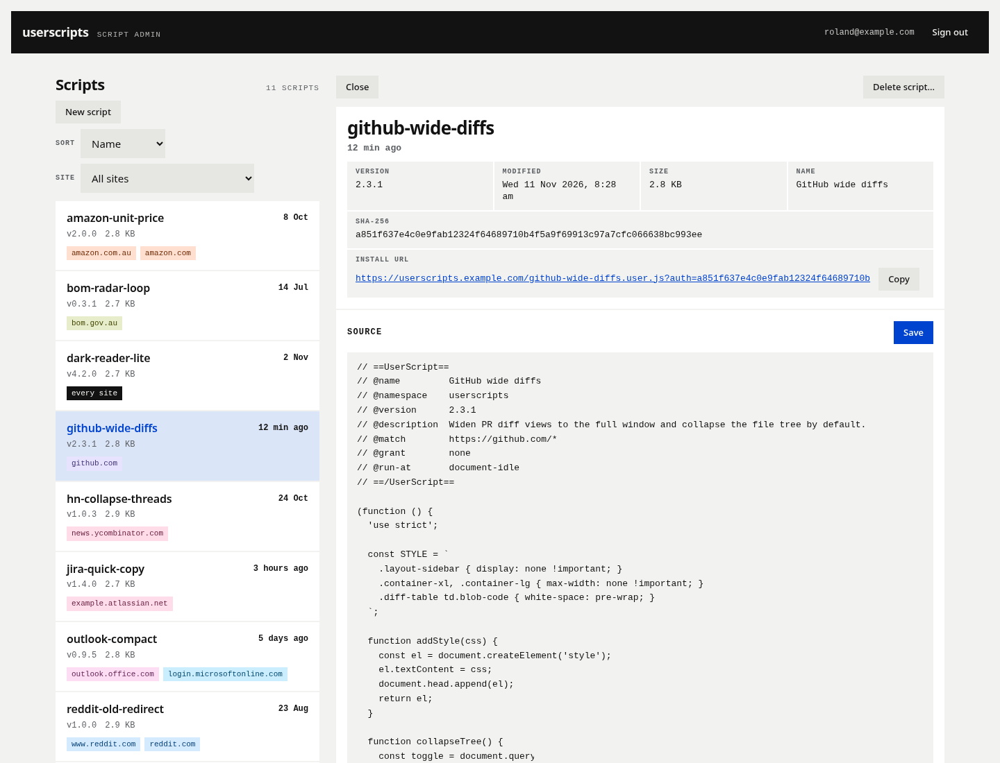
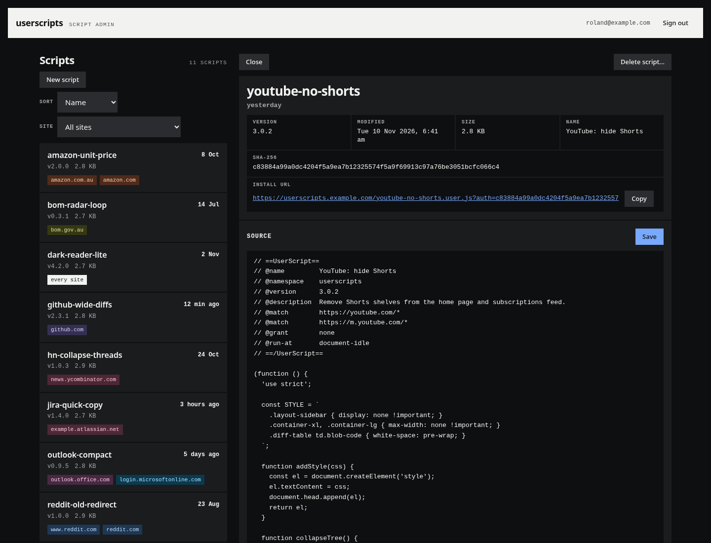

# userscripts

A small Go server that hosts private Tampermonkey userscripts, so installs update themselves.

<p align="center">
  
  &emsp;
  
</p>

## How it works

- Each script lives in `scripts/<name>.user.js` and gets a random read key in `keys/<name>`.
- Tampermonkey installs from `https://<DOMAIN>/<name>.user.js?auth=KEY`. The server adds
  `@updateURL` and `@downloadURL` (both carrying the key) when it serves the script, so later
  versions arrive automatically. Without the right key, every request gets the same 404.
- Scripts are viewed, created, edited and deleted in a dashboard at `https://<ADMIN_DOMAIN>/`, or
  through an MCP server for claude.ai (`/mcp`). Both sign in through Dex, and both admit only the
  emails in `MCP_ALLOWED_EMAILS`. There is no other way to change scripts.
- A new upload must have a higher `@version` than the stored one, because Tampermonkey ignores
  anything else.
- Every write is logged with the user who made it and, if configured, sent to ntfy.

### The dashboard

oauth2-proxy (the `userscripts-admin` service) sits in front of `ADMIN_DOMAIN`. It signs the
browser in with Dex (Dex client `userscripts-web`) and forwards each request to the server with the
Dex access token attached. The server checks that token with Dex on every request: it must have
been issued to `userscripts-web`, and its email must be in `MCP_ALLOWED_EMAILS`. Anyone else who
signs in gets a 403 page. The MCP server only accepts tokens issued to `userscripts-mcp`, so a
token for one can't be used on the other.

Sessions last 12 hours and are never renewed silently. The cookie is `__Host-` prefixed,
`Secure`, `HttpOnly` and `SameSite=Strict`, and writes must also carry an `X-Requested-With`
header. The page loads nothing from other origins and runs under a strict CSP.

The page follows a flat design system: `web/static/tokens.css` and `web/static/bundle.css` are
copied from it unchanged apart from their header comments. Refresh them by hand when the design
system changes; `web/static/app.css` holds the page's own additions.

## Prerequisites for hosting

- Docker with Compose.
- Traefik on the same host, with a `websecure` entrypoint, a `letsencrypt` cert resolver, and an
  external Docker network called `services`.
- Two DNS names pointing at that host: `DOMAIN` for scripts and the MCP server, `ADMIN_DOMAIN` for
  the dashboard.
- A Dex instance with:
  - a confidential client `userscripts-web` whose redirect URI is
    `https://<ADMIN_DOMAIN>/oauth2/callback`, for the dashboard;
  - optionally, for the MCP server, a public client `userscripts-mcp` that claude.ai can sign in
    through.
- Optional: an ntfy topic and token for write alerts.

## Running it

```sh
cp .env.example .env            # set the domains, Dex issuer, allowed emails and secrets
mkdir -p scripts keys && chown 1000:1000 scripts keys
docker compose up -d --build
```

Then open `https://<ADMIN_DOMAIN>/`, sign in, and choose New script. After saving, the facts card
shows the install URL: open it in a browser that has Tampermonkey to install the script.

## Development

```sh
go test ./...
```

The tests run the dashboard routes against a fake Dex.
